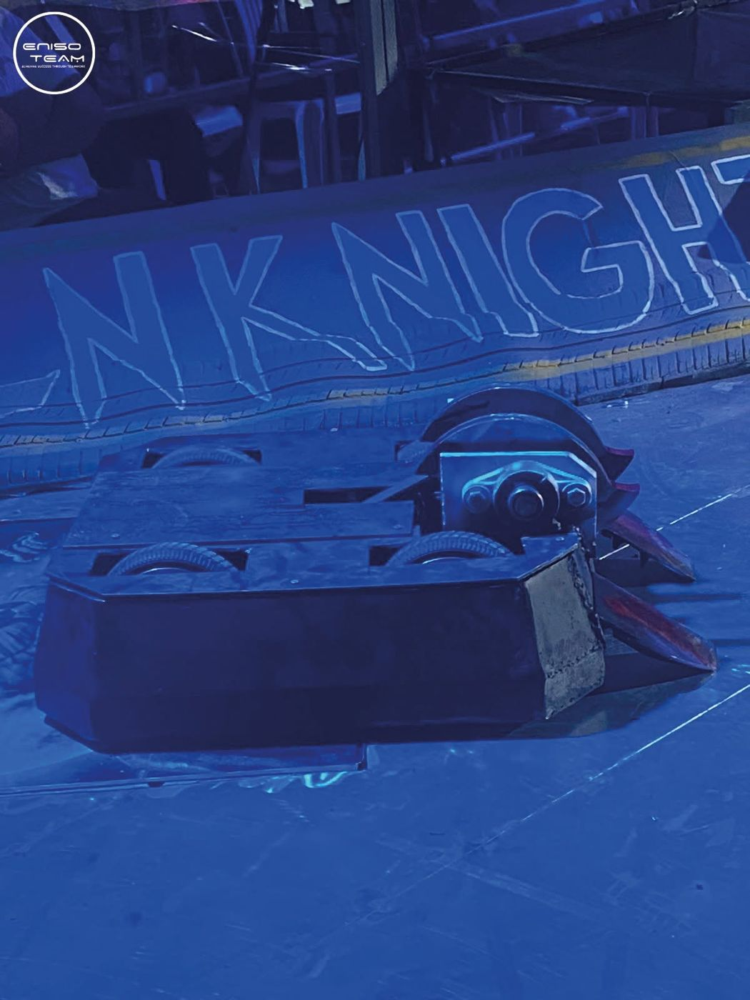
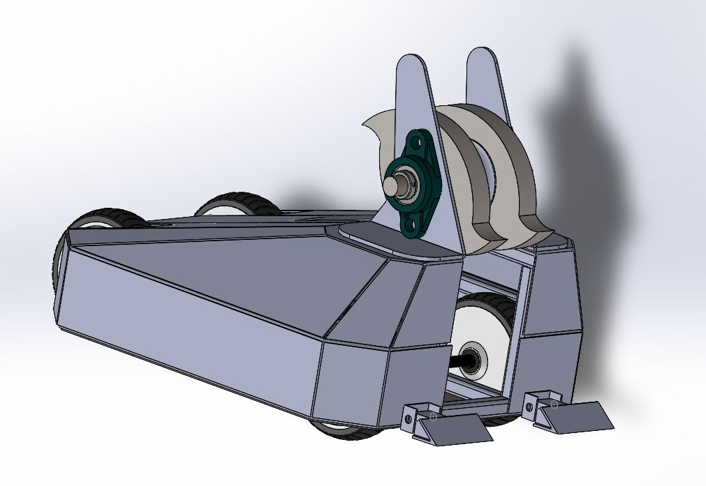

# Venom — robot de combat

> ENISo Smart Challenge (Eternova IX) · avril 2025 · ENISo, Tunisie
> *English summary below.*

Robot conçu pour encaisser des chocs violents en arène, avec une **arme tambour de 6 kg** (Ø240 mm, 2 750 tr/min). Le défi : un châssis à la fois léger et quasi indestructible, une propulsion puissante à faible coût et une commande assez réactive pour piloter en plein combat.

  
  

📄 **Rapport complet :** [`docs/rapport_venom.pdf`](docs/rapport_venom.pdf) · **Choix du matériel :** [`docs/choix_materiel.pdf`](docs/choix_materiel.pdf)

## Ce que contient le dépôt

| Dossier | Contenu |
|---|---|
| `cad/solidworks/` | Assemblage SolidWorks complet (`fighter bot.SLDASM`) : châssis en tôles mécano-soudées, arbre et poulie de l'arme, roues brushless d'hoverboard, rampe |
| `firmware/hoverboard_stm32/` | Firmware open-source reflashé sur les cartes STM32 d'hoverboard (ST-Link) pour piloter les moteurs brushless à la radio FlySky |
| `firmware/esp32_weapon/` | Commande marche/arrêt de l'arme sur ESP32 (manette Bluetooth → relais statique) |
| `electrical/` | Schémas Proteus de la commande de l'arme et des moteurs, batteries Li-Po 6S |
| `analysis/shaft_bending/` | Étude de flexion de l'arbre de l'arme |
| `analysis/abaqus_impact/` | Simulation de choc de l'arme sous Abaqus (journal + captures des résultats) |

## Points techniques

- **Mécanique** : châssis en tôles mécano-soudées conçu sous SolidWorks ; arme tambour entraînée par courroie.
- **Propulsion** : moteurs brushless de roues d'hoverboard, avec les cartes STM32 d'origine reprogrammées (ST-Link + firmware open-source), donc une propulsion puissante pour un coût très faible.
- **Arme** : commandée par un ESP32 via un relais statique.
- **Validation** : dimensionnement de l'arbre en flexion et simulation d'impact sous **Abaqus**.

> Les fichiers de résultats Abaqus bruts (`.odb`, `.stt`, `.inp`… plus de 500 Mo) ne sont pas versionnés : le journal `.jnl` permet de reconstruire le modèle.

---

### English summary

Combat robot with a 6 kg drum weapon (Ø240 mm, 2,750 rpm). Welded sheet-metal chassis designed in **SolidWorks**, propulsion from hoverboard brushless motors with **reflashed STM32 boards** and FlySky radio control, weapon switched by an **ESP32** through a solid-state relay, 6S Li-Po power, shaft bending study and impact simulation in **Abaqus**.
